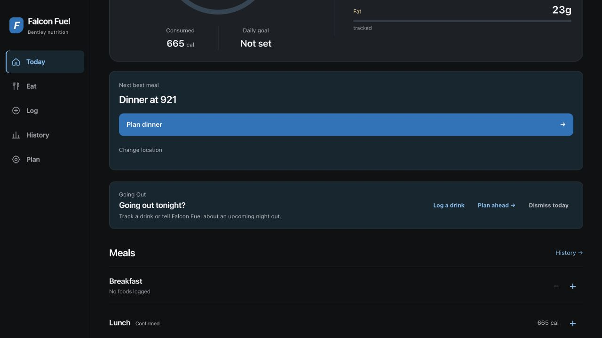

# Phase 1: critical audit corrections

Completed November 7, 2026 on `codex/phase1-critical-audit-fixes`, based on `6f9d581`. This implements F01, F02 and F03 from the [November 6 audit](../audits/2026-11-06/README.md). The original checkout and its uncommitted instruction files were preserved; implementation used an isolated clone in the selected project folder. Audit documents and original probe evidence were committed first. No student records were migrated, no production data or credentials changed, and no merge or deployment was performed.

## 1. Allergen evidence and restricted recommendations

**Defect/cause:** DOM imports retained “Milk, rice” but created an empty allergen array. Eligibility rejected only positive matches, treating missing information as compatible. API variants and composition components could also drop warnings.

**Change:** Introduced explicit per-allergen source exclusions (`sourceFreeFrom`). Missing or empty means unknown, not absence. Ingredient mentions add conservative warnings; they never establish absence. Positive declarations, cross-contact and ingredient signals override an exclusion. A specific published “milk-free” or “Free from: milk” statement supports only milk, not other allergens. A vegan label alone does not establish allergen absence. API and DOM import paths retain these distinctions. Merged variants union warnings and retain only shared exclusions; API merges preserve both inputs' allergen filters/ingredients. Customized recommendations check each selected component and require compatible evidence for a nonempty unremovable base. Dairy-free/gluten-free restrictions also use the evidence checks. Browsing, meal details, manual selection and logging disclose uncertainty rather than claiming suitability.

**Main files:** [allergenEvidence.ts](../../src/services/allergenEvidence.ts), [recommendationEligibility.ts](../../src/services/recommendationEligibility.ts), [recommendationCandidates.ts](../../src/services/recommendationCandidates.ts), [dineOnCampusParsing.ts](../../src/services/dineOnCampusParsing.ts), [manual921Sync.ts](../../src/services/manual921Sync.ts), [reliableDineOnCampusProvider.ts](../../src/services/reliableDineOnCampusProvider.ts), [mealCompositionConcepts.ts](../../src/services/mealCompositionConcepts.ts), [captureBookmarklet.ts](../../src/app/admin/921-sync/captureBookmarklet.ts), [menu types](../../src/types/menu.ts). UI changes are in the location/detail pages, both builder clients, MealFoodBrowser and CanonicalFoodPicker.

**Tests:** [allergenEvidence.test.ts](../../src/services/allergenEvidence.test.ts) covers the original milk reproduction, unknown/legacy information, unrelated exclusions, ingredients contradicting a free-from claim, positive and may-contain declarations, API conflicts, per-allergen support, and an unknown/incompatible base. Candidate tests reject unknown component evidence and still generate supported custom variants. Replacement and breakfast tests use explicit fixture evidence for their supported cases; production demo fixtures were not relabeled safe.

**Limits/new risks:** This deliberately reduces the number of restricted recommendations, potentially to zero. Ingredient matching is a warning heuristic, not a comprehensive ingredient parser; ambiguous mentions can conservatively exclude a dish. It does not certify source accuracy, kitchen practices or cross-contact safety. Existing snapshots without exclusion evidence remain unknown. No stored user data needs migration. Future operator fixtures should validate every supported source label before expanding the parser.

## 2. Dated menu availability and historical access

**Defect/cause:** Both aggregate and location reads preferred the last trusted publication over the requested date. A fallback read could move the current pointer. Search boosted records as available solely from verification status. Unknown meal periods became all-day, and a requested builder period could silently switch to a different published one.

**Change:** Dated reads select an exact snapshot first; the current pointer is usable only if its publication date matches. An old dated read does not republish or change the current pointer. Snapshot items must agree with the publication date and have period information. Unknown source periods are omitted instead of widened to all-day. A shared `publishedFor` predicate checks date, verification status and requested period for search and recommendation eligibility; composition actions retain their station's date/status. Today uses the Bentley clock, future builder context carries its requested date, and an explicitly requested period is retained. Historical foods remain searchable/loggable without an availability boost for another date/period. The logging date control reloads the dated catalog and filters out stale incoming items while navigation completes.

The location page offers a separately labeled last-publication disclosure, with its actual date and no current-availability claim. The public publication endpoint exposes its view/date, validates dates, explicitly does not certify current availability and no longer writes on GET. Historical item details retain the food's source date; their default manual-log link preserves retrospective intent. Captures require an explicit date in the source URL and a valid calendar date.

**Main files:** [diningAvailability.ts](../../src/services/diningAvailability.ts), [reliableDineOnCampusProvider.ts](../../src/services/reliableDineOnCampusProvider.ts), [diningSnapshotRepository.ts](../../src/services/diningSnapshotRepository.ts), [bentleyDiningDate.ts](../../src/lib/bentleyDiningDate.ts), [canonicalFoodCatalog.ts](../../src/services/canonicalFoodCatalog.ts), [published endpoint](../../src/app/api/dining/published/921/route.ts), [location page](../../src/app/locations/[locationId]/page.tsx), [logging page](../../src/app/log-meal/page.tsx), [logging client](../../src/app/log-meal/LogMealClient.tsx), both recommendation entry points and builder route.

**Tests:** [diningAvailability.test.ts](../../src/services/diningAvailability.test.ts) covers previous/current/future dates, lunch vs breakfast/dinner, explicit all-day, missing periods/date, stale status, date-and-period search ordering, UTC midnight vs Bentley date, both DST boundaries, future snapshots hidden behind old pointers, unknown source periods and impossible capture dates. Updated reliability tests retain same-day outage recovery but reject wrong-day publications. [Endpoint tests](../../src/app/api/dining/published/921/route.test.ts) verify historical/latest responses, missing-date 404, invalid-date 400 and unchanged publication pointers. Composition tests verify date propagation.

**Limits/new risks:** When no exact publication exists, the app now correctly offers fewer live choices. Authorized upstream access, durable publication receipts, the broad retry policy, cross-period recipe identity and historical snapshot retention remain separate audit items. Last-publication access is bounded by existing cache availability; this is not a durable archive. A currently open browser will reject a wrong date on its next computation, but this change adds no background midnight-refresh scheduler. Generic/staple plans remain estimates, not claims of a published offering. The distinct Falcon Market plan-intent defect F07 remains open.

## 3. Framework security patch

**Defect/cause:** Next 16.3.0 falls in the affected range of [GHSA-2xp9-vwfh-vxw4](https://github.com/vercel/next.js/security/advisories/GHSA-2xp9-vwfh-vxw4). The vendor identifies 16.3.3 as a patched 16.x version. Presence of the version was not evidence of exploitation.

**Change:** Pinned Next and eslint-config-next to 16.4.5 and regenerated the lockfile with the package manager. A clean `npm ci` completed. Reviewed transitive changes include aligned Next SWC/env/plugin packages, sharp 0.35.3 → 0.35.5, libvips 1.3.2 → 1.3.4, @swc/helpers, fastq and sharp's semver dependency. Auth.js, React and app authentication configuration were not changed.

**Evidence:** [Production audit](phase1-evidence/prod-audit.json), [full audit](phase1-evidence/full-audit.json), build and test results below. Next is absent from the refreshed vulnerability reports and critical count is zero. Full report: 15 affected package entries (7 high, 8 moderate); production-only: 5 high entries (`source-map-js`, `zod`, and the three affected Vercel dependency-chain entries). These are package entries, not five independently demonstrated exploits. The remaining high findings and dev-tool findings were not silently fixed, suppressed or accepted as harmless; prioritize an independently reviewed dependency follow-up. Do not use a force-fix or upgrade unrelated majors as part of this PR.

## Verification and baseline comparison

| Check | Phase 1 result | Audit comparison |
|---|---|---|
| Recursive full suite, UTC | **501/501 passing**, 82 files | Audit discovered 488 cases; only the two failing files had been rerun in UTC then. This phase adds 13 cases. |
| Recursive full suite, America/New_York | **498/501 passing; 3 failures** | Same three failure names and assertions as audit's 485/488. No new failing test remains. |
| Production webpack build | Pass on Next 16.4.5 | Audit passed on 16.3.0. |
| Typecheck | Pass | Baseline passed. |
| Lint | Zero errors; one preexisting unused `_date` warning | Same warning in mockDiningProvider.ts:42. |
| Mock dataset validation | Pass: 7 locations, 14 stations, 38 components, 32 menu items | Same counts and result. |
| Deterministic recommendation audit | Same weak target-fit warning and duplicate-alternative information; four other sections unflagged | No ranking-weight change in this phase. |
| Production dependency audit | No critical/Next findings; 5 high package entries remain | Original full-tree report had 17 entries including critical Next. Compare full report separately, not as if it were production-only. |
| Browser smoke | Onboarding → Market selection → 0 consumed pending → All → **665 kcal/45 g protein consumed**. Date changed to Nov 6; historical log dialog showed uncertainty and generic/recent fallback. | Preserved pending/consumed distinction; completed check-in persistence beyond original audit's limited observation. |

The three unresolved New York failures are `deepNutritionPatterns.test.ts:99`, `recommendationPreferenceLearning.test.ts:62` and `recommendationPreferenceLearning.test.ts:77`. They remain visible in the [New York log](phase1-evidence/full-ny.log); they were not skipped or made to pass by changing all app clocks to UTC. Local runs used Node 24.14.0; CI is configured for Node 20, so its result must be checked before merge.

Added [portable test enumeration](../../scripts/run-tests.mjs) because the old shell glob omitted auth/admin/deep route tests necessary to validate this change. `npm test` now includes all `.test.ts` files. CI also explicitly runs the critical regressions with America/New_York; this does not claim that the entire New York suite is green or implement the separate timezone cleanup.

### Browser/API/data boundaries

The browser used a fresh localhost origin and a synthetic profile with no measurements. No real student record or admin credential was used. The source → normalized snapshot → eligible candidates → dated search chain was verified with deterministic fixtures, and public/admin route tests cover access/validation. In the local browser, unavailable upstream data was honestly shown as unavailable while generic/demo workflows remained usable. The directory's existing transport generated 403 diagnostics; the audit's retry/access issue was not repaired in this phase. No live browser capture was published and no provider challenge was bypassed by the operator. Real vendor label coverage and an authenticated production publish remain untested.

## Review, rollback and next phase

Commits separate preservation, dependency patch, allergen correction, availability correction, and test infrastructure. Audit evidence constitutes much of the diff; review `src/`, package changes and the test runner independently. No old docs, existing plans, user history or branch refs were deleted. Ordinary code rollback is possible without a user-data migration; rolling back the eligibility or availability guards would reintroduce the documented safety defects. Operators need the updated capture bookmarklet for newly retained declaration text; old captures remain conservative.

**Next:** F05 line-based nutrient totals and quality recomputation (the fiber/sodium and estimate-status bugs), then F07 Falcon Market plan intent, followed by the three timezone fixtures/semantics and remaining high dependencies. Student accounts/cross-device sync should be a separate scoped phase with per-owner authorization, consented guest migration, conflict handling and deletion; do not conflate admin GitHub authentication with student persistence. Other audit defects and source-access arrangements remain open. Do not merge or deploy this branch without owner approval.
