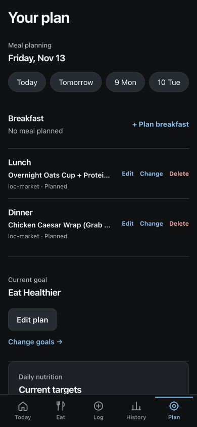

# Phase 2: nutrition and planning integrity

Completed November 9, 2026 on `codex/phase2-nutrition-planning-integrity`, based on verified main `e60e93dd92b330daa9ed1e365157bc0363a173d1`. The four existing implementation commits were recovered intact; no previous work was discarded. This report follows the [November 6 findings](../audits/2026-11-06/FINDINGS.md) and [roadmap](../audits/2026-11-06/ROADMAP.md).

## Findings corrected

### F05 — line nutrition and estimate quality

Canonical append/edit/remove now rebuild all nutrients from immutable saved food lines and beverages. This corrects the original two-food removal case (100 calories, 5 g fiber, 100 mg sodium remaining), replacement of a verified food with an estimate, and loss of optional nutrients in compositions. `sumNutrition` starts from actual contributors; an empty assembly or beverage list contributes known zero. A missing optional nutrient remains unknown, and removing its unknown contributor restores the known total. Explicit undefined fields stay unknown when scaled.

Estimate status is recomputed after edits/removals. Manual builder edits also recompute their label; menu availability and beverage availability do not establish nutrient accuracy. Newly saved recommended/manual builds capture their computed line nutrition, including quantities. The final review found and corrected a remaining persistence gap: the aggregate could be updated while an old food snapshot survived. The added regression proves that a subsequent canonical append/edit cannot restore the old totals. When the menu disappears, a complete food snapshot takes precedence over a component-only snapshot that may omit the base.

Portion selection, beverage quantity, served portion scale and consumption fraction are applied once at their respective boundaries. Existing Today/History consumers read the corrected saved aggregate. No bulk rewrite of historical records occurs.

**Legacy policy:** meals with incomplete saved line details can still receive additions using their preserved aggregate; unknown remains unknown. Partial removal/replacement that cannot be reconstructed is blocked with an explanation rather than guessing a residual. Removing the final food retains the existing whole-meal deletion behavior. Old incorrect records are not silently migrated. Builder snapshots with uncertain provenance are conservatively estimated; the broader source/identity work F04/F06 remains separate.

**Files:** `src/services/nutrition.ts`, `campusBeverages.ts`, `canonicalFoodLogging.ts`, `mealBuilder.ts`, `mealCompositionSnapshots.ts`; `src/app/log-meal/LogMealClient.tsx`; both meal-builder clients.

### F07 — intended date versus menu date

The route resolves typed plan/log/select intent independently of the venue's provider. Market plans now carry their intended date and save to the plan repository; retrospective Market logs retain their selected date/time and are consumed only through the retrospective save action. Current selection remains pending until check-in. Builder navigation retains the intended date, active periods follow changed route props, omitted planning periods get a campus-clock default, and brunch maps to the lunch history slot. The unavailable-menu message names the selected venue.

**Files:** `src/services/mealBuilderIntent.ts`, `mealHistoryRepository.ts`; `src/app/meal-builder/[locationId]/page.tsx`, `MealBuilderClient.tsx`, `ManualMealBuilderClient.tsx`.

### F13 — deterministic meal-time fixtures

The three New York failures described lunch/dinner/breakfast using UTC timestamps while the production learning logic interprets local meal time. Fixtures now construct local wall-clock meals and serialize the resulting instants. Calendar iteration and explicit evaluation dates remain deterministic. No application clock or global application timezone was changed. CI runs the entire recursive suite, typecheck, lint and build in both UTC and America/New_York.

**Files:** `src/services/deepNutritionPatterns.test.ts`, `recommendationPreferenceLearning.test.ts`, `.github/workflows/ci.yml`.

### Remaining high dependency advisories

The five production entries represented two vulnerable packages plus dependent Vercel chain entries, not five independently demonstrated exploits. The only application import of `@vercel/functions` is the dining cache; Zod is used by its CLI-config dependency for local configuration. Source-map-js is reached through PostCSS/Next/Tailwind source-map processing. No public request handler accepting attacker-supplied Zod collections or indexed source maps was found. This limited exposure supported releasing Phase 1 while the compatible patches were prepared; it was not a claim that the affected packages were harmless.

| Package | Before | After | Disposition |
|---|---|---|---|
| @vercel/functions | 3.9.7 | 3.10.6 | Minimal patched 3.x SDK, exact pin |
| @vercel/oidc | 3.8.7 | 4.0.6 | SDK's supported transitive dependency, no application OIDC API change |
| @vercel/cli-config | 0.2.6 | 0.3.6 | Removes vulnerable pinned Zod |
| zod | 4.1.11 / 4.4.3 | 4.6.7 | Compatible upstream dependency range, deduplicated |
| source-map-js | 1.2.1 | 1.2.2 | Compatible patch |
| brace-expansion | 1.1.18 | 1.1.21 | Development-only compatible patch |
| js-yaml | 4.3.1 | 4.3.2 | Development-only compatible patch |

Next and eslint-config-next remain at patched 16.4.5. No force-fix, Next downgrade or application major upgrade was used. Package-manager lockfile changes were reviewed.

Sources: [source-map-js release](https://github.com/7rulnik/source-map-js/releases/tag/v1.2.2), [Zod patch](https://github.com/colinhacks/zod/commit/a0ebf97), and the saved npm audit reports.

**Remaining:** eight moderate development-only package entries trace to [minimatch GHSA-g3hv-75wg-m249](https://github.com/advisories/GHSA-g3hv-75wg-m249), affecting versions 7–11.0.0. The patch is 11.0.1; the current TypeScript ESLint chain requires minimatch 10.x. Attacker-controlled optimized glob patterns can amplify CPU/memory consumption. No production exposure was identified; lint processes repository configuration. A supported upstream toolchain update should resolve this. Forcing a transitive major or npm's suggested eslint-config-next downgrade is outside this compatible correction. Production audit: zero entries. Full audit: zero high/critical, eight moderate.

## Verification

Recovered previous evidence: 510/510 tests in UTC and New York, passing typecheck/build, one preexisting lint warning, and the mobile walkthrough. The final persistence regression adds one test; final results below supersede those logs.

| Check | Final result |
|---|---|
| Full UTC tests | 511/511 pass |
| Full America/New_York tests | 511/511 pass |
| Targeted nutrition/planning/repository regressions | 20/20 pass |
| Typecheck | Pass |
| Lint | Zero errors; preexisting `_date` warning at mockDiningProvider.ts:42 |
| Production build | Pass, Next 16.4.5 webpack |
| Production npm audit | Zero vulnerabilities |
| Full npm audit | Eight moderate, zero high/critical |

Final logs and security reports are in [phase2-evidence](phase2-evidence). Local verification uses Node 24.14.0; GitHub Actions uses Node 20 and must be checked before a later merge. The original data validation also passed (7 locations, 14 stations, 38 components, 32 items); recommendation audit retained its existing target-fit/duplicate-alternative observations. No scoring weights changed.

**Tests added:** two canonical logging regressions (all nutrient/quality restoration and unsupported legacy edits), four nutrition integration regressions (composition totals, empty bases, beverage/portion/check-in accounting, and persisted builder edits), and four intent/date regressions. The existing three timing failures and brunch mapping expectation were corrected. No tests were skipped or assertions weakened to hide an application timezone error.

**Recovered browser evidence (390×844, synthetic localhost profile):** recommended Market lunch and manual Market dinner saved as Friday November 13 plans; Today stayed at zero consumed and no pending meal after planning. Retrospective Market lunch appeared on November 6 with 540 calories. A current 665-calorie selection appeared pending with zero consumed; a half check-in produced 333 displayed calories and 23 g protein, correctly rounded. These UI workflows are preserved from the preceding session rather than rerun unnecessarily. The final saved-line persistence change is covered by the new integration regression and full suites.

## Release state and limitations

Phase 1 PR #79 was made ready and merged under the owner's conditional release authorization at `e60e93d`. Its PR checks and main Actions passed. GitHub recorded successful production deployment 7630327410 for that merge SHA. Public production smoke checks verified onboarding navigation, impossible menu date returning HTTP 400 with `invalid-menu-date`, and unauthenticated publication returning HTTP 401. No production dining publication or student data was modified.

Direct Vercel team inspection returned HTTP 403, including after the owner reported approving team access. Consequently privileged runtime logs and a Vercel-side alias inspection were not verified. GitHub deployment evidence and public smoke tests were available; this limitation is not hidden. The protected preview was not bypassed or made public.

**Phase 2 is review-only:** do not merge or release it without another owner review. No manual Phase 2 deployment, environment change, migration, or production publication was performed. Git integration may create its normal preview on branch push.

F05 and F07's documented reproductions are corrected, subject to the explicit legacy policy above. No requested implementation item is intentionally unfinished. Remaining work is the documented moderate development dependency chain and independent audit findings. Recommended Phase 3: F04 source nutrient aliases/units/missing values; F09/F12 durable and validated publication receipts; F06/F10 stable food identity; F08/F14 nested plan validation and recoverable fulfillment. Authorized live dining access remains an external dependency.
